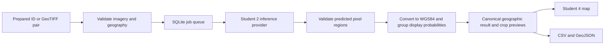

# 3. Backend, geography and exports

Implementation and local verification were performed on 23 November 2026. This section describes the implemented service and identifies integration evidence still required from the team. Teammate messages and milestone status are in [HANDOFFS.md](HANDOFFS.md).

## 3.1 Responsibilities and architecture

Student 3 implemented a local FastAPI service joining supported imagery, an inference-provider interface, geographic conversion, job tracking and downloadable results. SQLite stores job metadata. Image uploads, immutable job input records, previews and result artifacts are stored in a local runtime directory excluded from Git. Student 2 owns trained inference; Student 4 owns the browser map; Student 1 owns data preparation and evaluation.

The service follows this flow.



The implemented HTTP interface includes readiness, prepared examples, job submission/status, result retrieval, crop retrieval and CSV/GeoJSON downloads. Both JSON prepared requests and multipart uploads are documented in `contracts/API.md` and demonstrated in matching examples. The local Vite proxy routes `/api` to the backend; returned crop paths need that prefix in the frontend.

## 3.2 Input validation

Prepared examples are discovered from the Haiti imagery-only manifest and xBD pair sidecars. The server resolves submitted pair IDs through this registry. Header validation checks supported format, RGB bands, uint8 data, dimensions, matching CRS/grid, finite invertible affine transforms and geographic extent. Submission additionally decodes image pixels and checks GeoTIFF masks. GeoTIFFs with nodata and unsupported radiometry require model-compatible preparation. The upload body limit is 128 MiB, checked during streaming, and each image is limited to 4096×4096 pixels.

Prepared PNGs require geographic sidecars whose internal fit error is finite and at most one metre. RGB PNG transparent-color metadata preserves the underlying RGB pixels, matching the existing classifier data loader. A failed or absent transform excludes the example from the selectable registry. The service reports the excluded ID and reason.

Local inspection found 1,190 supported header records, comprising all 12 prepared Haiti GeoTIFF pairs and 1,178 xBD pairs. The other 162 xBD records lacked acceptable geographic transforms. Full pixel validation was repeated for one Haiti pair and one xBD pair. These counts describe input eligibility and do not measure model performance. Generated audit details are in local `runtime/backend_validation.json` and can be reproduced with the verification command below.

## 3.3 Job processing and storage

Each accepted request receives a unique job ID and a queued response. A single background thread transitions jobs through queued, running and completed or failed. A process-level operating-system file lock prevents two backend processes from sharing the same job store. SQLite writes are committed transactionally and connections are closed after each operation.

Validated inputs are written before queue insertion. Result JSON, geographic features, CSV and previews are written before the completed state is published. Failed jobs retain an explanatory error and their partial artifacts remain unavailable through result routes. An empty detection set completes with zero counts, an empty FeatureCollection and a header-only CSV.

On a normal shutdown, active inference finishes before storage ownership is released. On an unexpected restart, interrupted running jobs become failed with a retry explanation. Queued jobs resume once a genuine provider is configured. Completed jobs remain accessible. Results requested before completion return HTTP 409, unknown resources return 404, invalid inputs return 422, oversized bodies return 413 and unavailable inference returns 503.

## 3.4 Geographic conversion and validation

The service reuses the project's geographic helpers. Pixel polygon vertices are mapped through the six-coefficient affine transform and reprojected from the input CRS to WGS84. GeoJSON uses longitude followed by latitude. Polygon holes and region identity are retained. Invalid pixel polygons, out-of-bounds regions or invalid transformed geometry fail the job with an explanation.

For local prepared samples, pixel origin `(0,0)` converted to `(-72.349328869, 18.555751227)` for `haiti-earthquake_000001` and `(-79.05717570875653, 33.60771210743251)` for `hurricane-florence_00000000`. The latter sidecar records an internal fit error of about 0.0060 m. These values are transform checks; independent absolute-position validation remains unavailable.

Automated tests exercise known coordinates, rotated projected grids, polygon holes and invalid grids. CSV locations use an interior representative point, which also supplies the map link. EBD remains outside geographic mapping because established coordinates are unavailable.

## 3.5 Results, crop previews and exports

A canonical result retains four native probabilities in no/minor/major/destroyed order and their native class. The display grouping sums minor and major probabilities before choosing among no apparent damage, damaged and destroyed. Corresponding suggested tiers are lower, medium and high. Within each tier, regions remain tied.

The API translates the existing helper's `destroyed_or_collapsed` category into the agreed wire value `destroyed`. Results retain source image IDs, model version, pixel geometry, geographic geometry, building/group identity and predicted-footprint provenance. CSV includes native and display probabilities and geographic points. Both exports cover the entire completed job and preserve the API's IDs and total count. The frontend must distinguish filtered visible counts from the whole-job download scope.

Before/after previews use the classifier's agreed bounding box with 20% context per side and bilinear resizing to 224×224. The existing crop helper uses black padding beyond image edges. This differs from the team plan's wording about edge padding and needs Student 1/2 review before genuine model integration. The backend preserves the helper's current behavior.

## 3.6 Verification and integration evidence

Run these commands from the repository root.

```powershell
.\.venv\Scripts\python.exe -m pytest -q
.\.venv\Scripts\python.exe scripts/verify_backend.py --output runtime/backend_validation.json
.\.venv\Scripts\python.exe -m uvicorn backend.app:app --host 127.0.0.1 --port 8000 --reload
```

Local verification passed all 40 tests, including 23 backend cases and 17 existing source tests. Backend tests exercise normal API submission, uploads, configured-provider startup, queued/running behavior, serial execution, readable inference failures, empty detections, interrupted-job recovery, exclusive runtime ownership, restart persistence, coordinate ordering, projected grids, polygon holes, interior CSV points, crop retrieval, probability grouping and cross-export consistency. Test inference is supplied explicitly by tests, including a temporary test module exercising the normal provider-loading path. These tests establish service behavior using controlled outputs. The installed Starlette/httpx test client and affine multiplication emit deprecation warnings; the checks complete successfully.

A startup smoke check against the full local registry returned health status `ok`, `inference_ready=false`, 1,190 accepted pair headers, 162 rejected records and HTTP 200 for OpenAPI. Submission without a model provider returned HTTP 503 as intended.

The normal server starts with `inference_ready=false` until Student 2's callable provider is configured. No trained damage checkpoint or complete pair-to-region inference function is available locally. Remaining integrated evidence is a genuine prepared-pair job and uploaded-pair job, checkpoint identity, Student 4's map/screenshots and count/download checks, plus reproduction on a second laptop. Record actual commands, test totals, job IDs and artifacts when those gates are completed.

## 3.7 Limitations and contribution

Student 3's implemented contribution covers pair validation, persistent jobs, geographic conversion, canonical results, preview crops, CSV/GeoJSON exports and the supporting API/tests. The project operates locally with one inference job at a time. Imagery preparation and model readiness constrain supported inputs. Detected connected regions may contain multiple buildings.

xBD geography derives from annotation correspondences; internal consistency does not establish independent absolute accuracy. Genuine inference must preserve detector/checkpoint provenance, including possible xBD pretraining overlap. Suggested inspection tiers represent grouped image-based model output. Quantitative classifier results and evaluation limitations must come from Students 1 and 2. Final integration and second-laptop reproduction remain pending.
